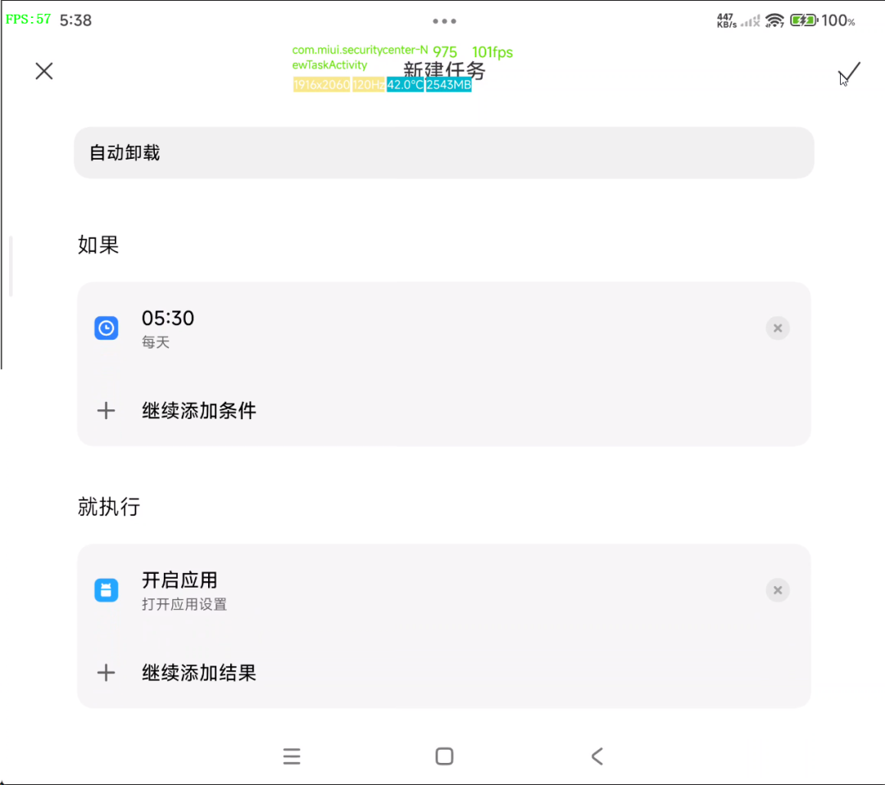

[简体中文](./README.md) | English

# App Settings Launcher

A tiny Android launcher APK: opening it **jumps straight to Xiaomi's "Application
settings" screen**, then closes itself. No background residue, no entry in Recents.

Jump target:

```
package  com.miui.securitycenter
activity com.miui.appmanager.AppManagerMainActivity
```

It exists to act as a bridge for the system's automated tasks — those can usually
only "launch an app" and cannot start a specific Activity directly. Once this APK is
installed, "launch App Settings Launcher" is equivalent to opening
**Settings → Application settings**.

---

## Download

Grab the latest `AppSettingsLauncher.apk` from the
**[Releases page](https://github.com/MXDexRazero/app-settings-launcher/releases/latest)**
and install it on your phone.

About **9 KB**, no permissions requested, no network access, no data collection.

---

## Usage

### Step 1: Install and verify

1. Download and install `AppSettingsLauncher.apk`
2. An icon named **应用设置** appears on your home screen
3. Tap it — **Settings → Application settings** should open directly, with no
   intermediate screen

If nothing happens, the target Activity cannot be started from outside on your
device or OS version.

### Step 2: Configure the automated task

Open the system's **Automated tasks** (inside Security service) → create a new task:



| Section | Setting |
|---|---|
| Task name | 自动卸载 (auto uninstall) |
| If (condition) | Specific time, e.g. `05:30` / every day |
| Then (result) | Open app → choose **应用设置** |

Save it. At the scheduled time the system launches Application settings, and the
GKD subscription takes over from there.

### Step 3: Pair it with the GKD subscription

This APK only *opens* Application settings. Everything after that is driven by the
**[gkd_subscription](https://github.com/MXDexRazero/gkd_subscription)** subscription:

```
Automated task (schedule) → this APK opens Application settings →
GKD: tap Security service → Uninstall updates → OK → exit Settings
```

Both repos must be set up for the full chain to work. Subscription link:

```
https://raw.githubusercontent.com/MXDexRazero/gkd_subscription/main/dist/gkd.json5
```

---

## What the rule does

After the app list appears, three rules fire based on screen features
(no `preKeys` — see below):

| Step | Matched by | Action |
|---|---|---|
| 1 | Clickable ancestor of `TextView[vid="am_label"][text="安全服务"]` | Enter the details page |
| 2 | Title is 安全服务 **and** 卸载 updates button exists | Tap Uninstall updates |
| 3 | Dialog titled 要卸载更新吗？ | Tap `android:id/button1` (OK) |

Every rule sets `matchDelay` + `actionDelay` to dodge the entry animation of
Xiaomi's Settings screens. The group ships with `enable: false`, so you must
turn it on manually.

### Heads-up: why the screen vanishes

The 安全服务 app *is* `com.miui.securitycenter` — the same package that hosts the
Application settings screen. Uninstalling its updates `forceStop`s the app itself,
so the screen disappears and you land back on the home screen. **Expected,
not a broken rule.**

---

## Required setup on Xiaomi / HyperOS

Skipping these causes intermittent failures:

1. Long-press GKD in Recents → **Lock** it so it is not cleared
2. Settings → Apps → GKD → Battery saver **No restrictions** + enable **Autostart**
3. Battery → App settings → GKD → No restrictions
4. HyperOS recycles third-party accessibility services when idle. If rules stop working,
   go to **Additional settings → Accessibility → Downloaded services** and tap GKD once

## FAQ

**Nothing happens after I open Application settings**

- Check that GKD's accessibility service shows as running
- Check that the rule group is enabled (it is off by default)
- Check that the screen title is 应用设置

**The log says it triggered, but the screen did not change**

GKD's `preKeys` conflicts with `matchDelay` / `actionDelay`, which can cause the click
to be dropped. This subscription avoids `preKeys` and matches on screen features instead.
If it still happens, increase the delay one notch.

**It may get auto-updated again**

Xiaomi's app store can re-push updates for system apps. Disable auto-update there if you
want it to stay rolled back.

## Related project

- **[gkd_subscription](https://github.com/MXDexRazero/gkd_subscription)**
  — the companion GKD subscription that handles every tap after the
  Application settings screen is open

---

[→ Go to gkd_subscription (subscription repo)](https://github.com/MXDexRazero/gkd_subscription)
